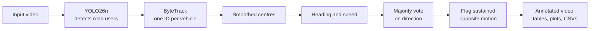

# Wrong-way vehicle detection with YOLO26 and ByteTrack

A Google Colab notebook that finds vehicles moving against the flow of traffic in a video from a fixed camera. It detects road users with a pretrained YOLO26 model, tracks them with ByteTrack, works out the direction most of the traffic is moving in, and flags any vehicle that keeps moving the opposite way.

The correct direction is learned from the clip itself, so there is no lane annotation, camera calibration or model training to do. You give it a video and it returns an annotated copy with wrong-way vehicles boxed in red, along with a table, plots and CSV files describing every tracked object.

## How it works

1. **Detection and tracking.** Every frame goes through YOLO26n (pretrained on COCO), and ByteTrack links the detections into tracks with persistent IDs. This is the only step that reads the video frame by frame.
2. **Motion.** Each track's box centre is smoothed with a moving average, and its velocity is measured over a short window. Speed is expressed in *box diagonals per second* (pixel speed divided by the size of the vehicle's box), so a small car far from the camera and a large car close to it are treated alike.
3. **Majority direction.** Every moving track casts one vote with its average heading. The heading that the most other tracks agree with, within ±45°, becomes the majority direction for the clip. Because this runs after tracking is finished, a vehicle that appears alone at the start of the video is still judged against all the vehicles that pass later.
4. **Wrong-way rule.** A vehicle is flagged **WRONG WAY** when its heading stays more than the opposite angle (120° by default) away from the majority for at least 0.5 s. It must also have been detected for most of that time, and it must travel at least half a box diagonal against the flow. Headings between 45° and the opposite angle are labelled *crossing*.
5. **Optional camera-motion compensation.** For panning or shaking cameras, the notebook tracks background corners with Lucas–Kanade optical flow, fits the camera's motion with RANSAC and removes it from the vehicle positions.

## Quick start

1. Open the notebook in Colab using the badge above, or upload `wrong_way_detector.ipynb` at [colab.research.google.com](https://colab.research.google.com).
2. Switch to a GPU runtime: *Runtime → Change runtime type → T4 GPU*. It also runs on CPU, but several times slower.
3. In the **Settings** cell, choose a video source:
   - `upload` asks you to pick a file from your computer.
   - `url` downloads a direct video link or a YouTube link.
   - `path` uses a file already in Colab or on Google Drive.
   - `demo` builds a short synthetic clip so you can try the notebook without your own video.
4. Run everything with *Runtime → Run all*.

The last cell zips the outputs and downloads them.

### Preparing your own videos

The method assumes that the camera does not move and that most of the moving traffic in the frame travels in one direction. If a video shows both directions of a road, crop it to a single carriageway first, otherwise the two directions compete for the majority.

### YouTube downloads

YouTube sometimes blocks downloads from Colab's servers with a "confirm you're not a bot" check. If that happens, export a `cookies.txt` file from a browser where you are signed in to YouTube, upload it through Colab's Files panel and set `YT_COOKIES_FILE` to its path. Delete the file from Colab when you are done, because it gives access to your account. Downloading the video yourself and using `upload` also works.

## Settings

| Setting | Default | What it does |
|---|---|---|
| `MODEL_NAME` | `yolo26n.pt` | Detector. Larger models (`yolo26s`, `yolo26m`) are more accurate and slower. |
| `TRACKER` | `bytetrack.yaml` | Tracker. `botsort.yaml` is the alternative. |
| `CLASSES` | `all` | COCO classes to keep, for example `car, motorcycle, bicycle, bus, truck`. |
| `CONF` | 0.3 | Detection confidence threshold. |
| `IMGSZ` | 640 | Input size for the detector. |
| `COMPENSATE_CAMERA_MOTION` | `False` | Removes background motion for panning or shaking cameras. |
| `MAJORITY_WINDOW_SEC` | 0 | 0 uses one majority direction for the whole video; a positive value recomputes it over a sliding window of that many seconds. |
| `OPPOSITE_ANGLE_DEG` | 120 | Angle from the majority beyond which a heading counts as opposite. |
| `WITH_FLOW_ANGLE_DEG` | 45 | Angle within which a heading counts as moving with the flow. |
| `MIN_SPEED` | 0.01 | Speed in box diagonals per second below which an object counts as stationary. |
| `MIN_OPPOSITE_SEC` | 0.5 | How long a vehicle must keep moving the wrong way before it is flagged. |
| `MIN_OPPOSITE_DIST` | 0.5 | How far, in box diagonals, it must travel against the flow during that time. |
| `MIN_TRACKS_FOR_MAJORITY` | 2 | Minimum number of agreeing tracks before a majority direction is accepted. |
| `SMOOTH_SEC` | 0.5 | Length of the moving average applied to box centres. |
| `VEL_LAG_SEC` | 1.0 | Time window used to measure velocity. |
| `MAX_SECONDS` | 0 | Process only the first N seconds (0 means the whole video). |

## Outputs

Everything is written to `wrong_way_outputs/` and zipped at the end of the run.

| File | Contents |
|---|---|
| `annotated.mp4` | The input video with colour-coded boxes, motion trails, heading arrows and a panel showing the majority direction. Red boxes are wrong-way vehicles, green move with the flow, yellow are crossing and grey are stationary. |
| `tracks.csv` | One row per tracked object: class, time in view, overall heading, median speed, share of time with the flow or opposite, and when and for how long it went the wrong way. |
| `detections.csv` | One row per object per frame, with box, velocity, angle to the majority and state. |
| `trajectories.png` | Trajectories drawn over a frame of the video, and a polar plot of each object's heading. |
| `wrong_way_snapshots.png` | Close-up crops of each flagged vehicle. |

## Results

We evaluated the notebook on fixed-camera traffic clips collected from YouTube and news channels and cropped to one direction of travel. Each vehicle was labelled by hand as moving in the correct or the wrong direction and compared with the notebook's flags.

| Metric | Value |
|---|---|
| F1 score | 0.82 |
| Accuracy | 0.81 |
| False positives | close to zero |

With almost no false positives, a vehicle moving the right way was very rarely flagged. Most errors were wrong-way vehicles that were not flagged, which follows from the duration and distance checks in the wrong-way rule: they reject uncertain cases at the cost of some missed detections.

## Tuning tips

| Problem | What to try |
|---|---|
| Parked or queued vehicles are flagged | Raise `MIN_SPEED` or `MIN_OPPOSITE_DIST`. |
| A real wrong-way vehicle is missed | Lower `OPPOSITE_ANGLE_DEG` or `MIN_OPPOSITE_SEC`, or lower `CONF` so the vehicle is tracked more continuously. |
| Short false alarms when IDs swap in dense traffic | Raise `MIN_OPPOSITE_SEC`, try `botsort.yaml` or a larger model. |
| "No clear majority" | Traffic in both directions is balanced. Crop the video to one carriageway or restrict `CLASSES`. |
| The main flow changes during the video | Set `MAJORITY_WINDOW_SEC` to 10–30. |
| Every vehicle or no vehicle is flagged | The camera is probably moving. Turn on `COMPENSATE_CAMERA_MOTION`. |
| A two-wheeler is flagged twice | With `CLASSES = all`, the rider is detected as `person` and the vehicle as `motorcycle` or `bicycle`. Restrict `CLASSES` to vehicle classes. |
| Processing is slow | Use a GPU runtime, set `IMGSZ` to 480, or test on a short section with `MAX_SECONDS`. |

## Limitations

- **Dashcam video does not work.** When the camera itself moves forward, everything in the frame streams past it, so the direction of a vehicle in the image no longer matches its direction on the road. Camera-motion compensation handles panning and shaking, but not a camera travelling through the scene.
- **The majority is assumed to be right.** If most vehicles in a clip were moving the wrong way, the legal ones would be flagged instead.
- **Directions are measured in the image.** Motion straight towards or away from the camera shows up as little sideways movement, and the box-diagonal speed is only an approximation of real speed.
- **COCO classes don't fit Indian traffic well.** COCO has no class for auto-rickshaws and some other vehicles common on Indian roads, so the detector may miss or mislabel them.

## Requirements

The first cell installs everything it needs: `ultralytics`, `lap` and `tqdm`, plus `yt-dlp` and `deno` when a YouTube link is used. OpenCV, PyTorch, NumPy, pandas and Matplotlib come preinstalled on Colab. To run the notebook outside Colab you also need `ffmpeg` on the system path for the video re-encoding step.

## Acknowledgements

- [Ultralytics YOLO](https://docs.ultralytics.com/models/yolo26) for the detector and the tracking interface.
- Y. Zhang et al., "ByteTrack: Multi-object tracking by associating every detection box," ECCV 2022.
- N. Aharon, R. Orfaig and B.-Z. Bobrovsky, "BoT-SORT: Robust associations multi-pedestrian tracking," arXiv:2206.14651, 2022.
- T.-Y. Lin et al., "Microsoft COCO: Common objects in context," ECCV 2014.

## License

Ultralytics YOLO is released under the [AGPL-3.0 license](https://github.com/ultralytics/ultralytics/blob/main/LICENSE). Keep this in mind when choosing a license for this repository.
